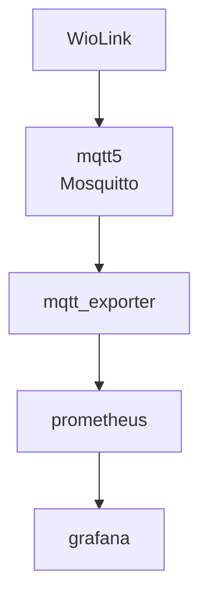

# WioGreenHouseDocker

Server components for the WioGreenhouse project:
- Mosquitto
- Prometheus
- Grafana

## Mosquitto

Topics published by WioLink have this format:

wioLink / *station_serial_number* / [ sensors | relays ]

Sensors payload:

{
	temperature: *float*,
	humidity: *float*,
	lux: *int*
}

Relays payload:

{ 
	relay1: *int*,
	relay2: *int*
}

### Reference
https://github.com/sukesh-ak/setup-mosquitto-with-docker
https://github.com/eclipse-mosquitto/mosquitto/issues/1078
https://stackoverflow.com/questions/57361075/docker-compose-command-is-failing-with-conflict

### Issues encountered

docker logs -tail 25 --follow mqtt5 --> Unable to open config file
This was resolved by setting owner and group to 1883 on the config and logs hierarchies

Warning: File /mosquitto/config/pwfile has world readable permissions. Future versions will refuse to load this file.
To fix this, use `chmod 0700 /mosquitto/config/pwfile`.Warning: File /mosquitto/config/pwfile owner is not root. Future versions will refuse to load this file.To fix this, use `chown root /mosquitto/config/pwfile`.Warning: File /mosquitto/config/pwfile group is not root. Future versions will refuse to load this file./ # 

sudo apt install mosquitto-clients

## Prometheus
Most of the code for the Python script was created by ChatGPT
https://prometheus.io/docs/concepts/data_model/
https://prometheus.io/docs/concepts/metric_types/
https://eclipse.dev/paho/files/paho.mqtt.python/html/client.html
https://github.com/docker/awesome-compose/blob/master/prometheus-grafana/README.md

https://prometheus.github.io/client_python/

https://eclipse.dev/paho/files/paho.mqtt.python/html/migrations.html

## Grafana
https://grafana.com/docs/grafana/latest/setup-grafana/installation/docker/
https://grafana.com/docs/grafana/latest/administration/provisioning/

## Ports:
- Mosquitto: 1883, 9001
- Prometheus: 9090
- Grafana: 3000
- MQTT exporter: 8080

